  <picture>
    <source media="(max-width: 600px)" srcset="./assets/banner-mobile.svg">
    
  </picture>

  i build fast little tools in rust and go. 
  usually on linux, probably in a terminal.

 

<picture>
  <source media="(max-width: 600px)" srcset="./assets/stats-mobile.svg">
  
</picture>

<picture>
  <source media="(max-width: 600px)" srcset="./assets/activity-mobile.svg">
  
</picture>

| | |
| :--- | :--- |
| **main** | Rust · Go |
| **also** | C · C++ · Zig · Python · TypeScript |
| **desktop** | CachyOS · niri · Vesper, my own Quickshell shell with a dynamic island |
| **terminal** | foot · fish · yazi · neovim / zed |

every image here is drawn pixel by pixel by a small python script, no fonts, no frameworks. the panels refresh daily from public github data.
