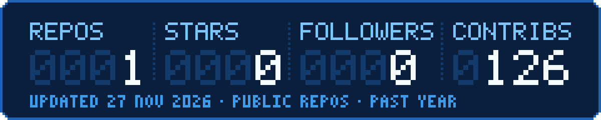
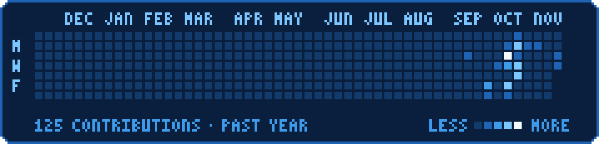

  <picture>
    <source media="(max-width: 600px)" srcset="./assets/banner-mobile.svg?v=2">
    
  </picture>

  i build fast little tools in rust and go. 
  usually on linux, probably in a terminal.

 

<picture>
  <source media="(max-width: 600px)" srcset="./assets/stats-mobile.svg">
  
</picture>

<picture>
  <source media="(max-width: 600px)" srcset="./assets/activity-mobile.svg">
  
</picture>

<picture>
  <source media="(max-width: 600px)" srcset="./assets/loadout-mobile.svg">
  
</picture>

 

<picture>
  <source media="(max-width: 600px)" srcset="./assets/footer-mobile.svg">
  
</picture>
